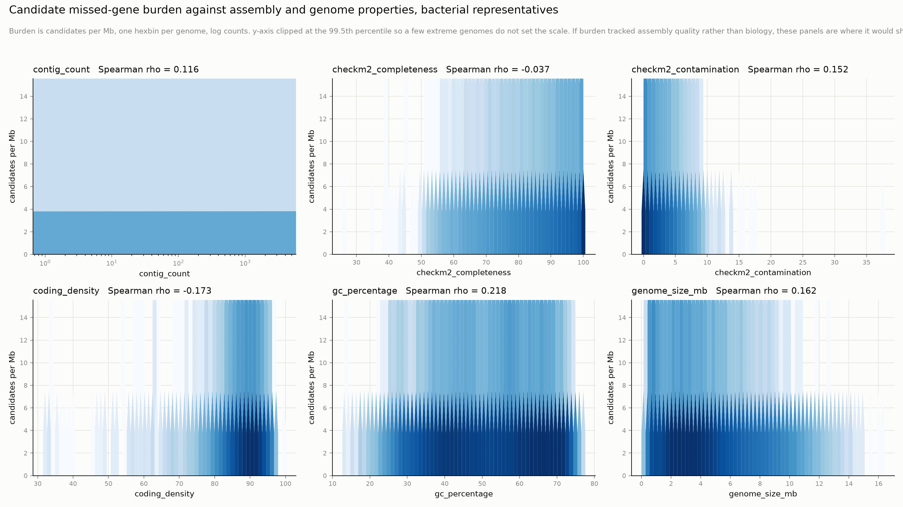
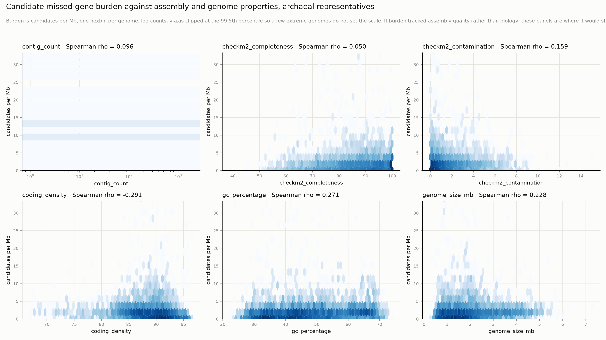

# GTDB r232 missed-gene analysis: supplementary analyses

Companion to [`scientific_report.md`](scientific_report.md) §6 and §6.1. It
covers analyses whose data existed but which the report never wrote up, plus
checks of a few numbers the report quotes. It does **not** edit the report.
Proposed corrections are listed at the end (§12).

Produced 2026-10-14 on Pawsey Setonix from the project's OneDrive mirror
(`genome_entropy:General/missed_genes/`). The Gadi population tables were not
reachable. Nothing was re-searched or re-encoded: every number below comes from
the same Foldseek best-hit tables, Prodigal coincidence tables and ranked
candidate tables that §6.1 used.

## 1. Inputs, methods and reproduction

| input (OneDrive path under `missed_genes/`) | used for |
|---|---|
| `full_bac/wanted.tsv`, `pilot_arc/wanted.tsv` | query set: arm, length, 3Di entropy, contig truncation |
| `full_bac/search_pooled/best/*.m8`, `pilot_arc/search/best/*.m8` | best hit per query (max bits), 4 DBs × {struct, seq} + shuffled null |
| `full_bac/prodigal_bac4.coincidence.tsv.gz`, `pilot_arc/prodigal_arc4.coincidence.tsv.gz` | Prodigal 3′ offset and coincidence; shadow `cds_frame_class` |
| `full_bac/func_bac_classified.tsv.gz`, `pilot_arc/func_arc_classified.tsv.gz` | #97 criteria C2–C7, functional class, BFVD-only flag |
| `candidate_burden_{bac,arc}.tsv` | per-genome GTDB r232 metadata (N50, CheckM2, genome size, …) as joined by `16_candidate_burden.py` |

**GTDB metadata.** No GTDB release exists under `/scratch/references`. None
was downloaded either, because `candidate_burden_*.tsv` already carries the
r232 `bac120`/`ar53` metadata columns for every annotated genome: 96,875
bacterial and 5,492 archaeal genomes, none missing N50.

**Scripts** (new, in `scripts/`):

- `34_supplementary_arms.py`. Joins the inputs into one row per query ORF and
  writes one TSV per analysis plus a text report.
- `35_supplementary_figures.py`. Draws every `supp_*.png` from those TSVs.
- `36_candidate_burden_figures.py`. Regenerates `candidate_burden_{bac,arc}.png`.

**Slurm jobs** (account `pawsey1018`):

- `34` ran for bacteria on `work` (4 cores, 60 GB; ~2 min, 4.9 GB max RSS) and
  for archaea on `debug`, several iterations each. The final runs were jobs
  50802762 (arc) and 50802763 (bac).
- Job 50802074 (`copy` partition) failed harmlessly. The archaeal `best/`
  directory turned out to exist on the remote already, so it was copied
  directly.
- Figures were drawn on the login node from the small TSVs.

**Arms.** These match §6.1:

- `candidate`;
- `shadow_hi` ("all shadows", 1:1 matched to candidates on length and 3Di
  entropy);
- `annotated_cds`;
- `intergenic_lo`;
- `unannot_hi`;
- **`clean_shadow`**: the antisense plus same-strand-frameshift subset of
  `shadow_hi`, which is the comparator §6.1 quotes. Bacteria 292,527;
  archaea 13,945.

**Readouts.**

- *Any hit*: a best hit at E < 1e-3.
- *Full-length*: the best hit has qcov ≥ 0.8 **and** tcov ≥ 0.8.
- *Union*: any of the four databases.
- *est*: any of Swiss-Prot, PDB100 and CATH50, i.e. BFVD excluded, as in §6.1.
- *Prodigal*: the 3′ end coincides exactly with a GTDB Prodigal gene (offset
  0 bp, as calibrated in `24_prodigal_overlap.py`).

**Reproduction check.** Before reporting anything new, `34` reproduces the
published numbers exactly, in both domains:

- every hit-rate, union, quality and truncation number in
  `analysis_v3_{bac,arc}.txt`;
- the clean-comparator coverage and mixture shares (23.3 / 23.4 / 27.0%
  bacteria; 26.2 / 28.3 / 36.4% archaea);
- the clean-shadow ladder: C3 90,658 vs 15,735 shadows; C7 23,540 vs 2,408;
  archaeal C7 1,574 vs 283;
- the Prodigal arm rates (47.42 / 9.41 / 9.85 / 94.21%; 55.36 / 16.00 /
  15.44 / 96.13%);
- the burden ρ values of the §6 table;
- C3 recomputed from the hit tables agrees with the ranked table's C3 for
  100.000% of candidates;
- `wanted.truncated` agrees with the context tables' `truncated_calc` for
  100.000% of ORFs.

---

## 2. Item 1: hit rate by 3Di entropy (why "hit rate is the wrong readout")

`18_pilot_analysis.py` binned 3Di entropy into quintiles of the **pooled**
query set. Because `intergenic_lo` is low-3Di by construction, its bacterial
Q1 runs from 0 to 2.54 bits, below the 2.5-bit candidate threshold. Those
pooled numbers are reproduced exactly. Candidates go from 15.2 → 20.7 → 34.7
→ 63.6 → 94.1% and all shadows from 13.7 → 97.9%.

The figure instead bins on **candidate quintiles**: bacteria 2.50 / 2.60 /
2.74 / 2.93 / 3.22 / 4.14 bits; archaea 2.50 / 2.63 / 2.80 / 3.01 / 3.32 /
4.11. The same edges are applied to every arm.

Any structural hit, % of arm (bacteria):

| 3Di bin | candidate | clean shadow | all shadows | annotated | unannot_hi |
|---|---:|---:|---:|---:|---:|
| Q1 2.50–2.60 | 17.2 | 6.8 | 15.6 | 25.1 | 44.6 |
| Q3 2.74–2.93 | 40.7 | 20.1 | 43.0 | 74.2 | 67.3 |
| Q5 3.22–4.14 | 94.2 | 88.4 | 98.0 | 98.6 | 98.3 |

Full-length hit (Swiss-Prot/PDB/CATH), % of arm (bacteria):

| 3Di bin | candidate | clean shadow | all shadows | annotated | unannot_hi |
|---|---:|---:|---:|---:|---:|
| Q1 | 3.2 | 0.8 | 2.1 | 12.3 | 20.3 |
| Q3 | 7.7 | 3.8 | 6.6 | 34.7 | 26.7 |
| Q5 | 47.0 | 42.7 | 41.5 | 79.4 | 70.0 |

Archaea follow the same pattern:

- Any hit in Q5: candidate 98.7, clean shadow 98.5, annotated 99.4%.
- Full-length in Q5: 58.1 / 52.8 / 84.4%.

**What this shows.**

1. **Any-hit rates converge on ~95–99% in the top quintile for every
   protein-like arm.** This includes antisense and frameshifted shadows, which
   cannot be the annotated protein. That confirms the report's point that hit
   rate saturates on encoder confidence.
   - The report's specific threshold ("above 3Di 3.38 bits everything hits
     at 99%") is not reproduced by any binning here.
   - The nearest statement the data support: in the top candidate quintile
     (≥3.22 bits, bacteria; ≥3.32 bits, archaea), 88–99% of every protein-like
     arm hits.
2. **Full-length coverage does not fully escape the same problem.** In the
   top quintile, candidates and clean shadows are only 4–5 points apart on
   full-length coverage. Clean shadows reach 43% (bacteria) and 53% (archaea).
3. **The within-bin real-gene share is lower than the pooled one at every
   level of 3Di.**
   - Bacteria, Swiss-Prot: 13.4, 8.7, 11.8, 18.9, 4.2% across the quintiles,
     against 23.3% pooled.
   - Archaea: 24.5, 14.7, 18.5, 16.1, 1.1%, against 26.2% pooled.

   A pooled estimate higher than every stratum is the signature of a
   confounded comparator. §8 below follows this up.
4. **Prodigal agreement rises with 3Di in every arm.**
   - Clean shadows rise from 3.7% to 52.4% (bacteria).
   - Candidates stay well above clean shadows in every bin: 31.0 vs 3.7% in Q1
     and 69.9 vs 52.4% in Q5.

## 3. Item 2: best-hit quality by arm

Median over queries with a struct-mode hit, AFDB/Swiss-Prot. Full table for
all four databases: `out/*/hit_quality.tsv`, struct and seq modes, all hits
and full-length hits.

Bacteria:

| arm | fident | qcov | tcov | bits | −log10 E |
|---|---:|---:|---:|---:|---:|
| candidate | 0.220 | 0.871 | 0.640 | 388 | 7.2 |
| clean shadow | **0.192** | 0.812 | 0.578 | 320 | 5.7 |
| all shadows | 0.315 | 0.865 | 0.577 | 586 | 12.3 |
| annotated CDS | 0.342 | 0.904 | 0.957 | 525 | 11.1 |
| intergenic_lo | 0.143 | 0.899 | 0.472 | 238 | 4.5 |
| unannot_hi | 0.301 | 0.871 | 0.921 | 445 | 8.8 |

Archaea:

| arm | fident | qcov | tcov | bits | −log10 E |
|---|---:|---:|---:|---:|---:|
| candidate | 0.217 | 0.885 | 0.654 | 413 | 7.8 |
| clean shadow | 0.239 | 0.871 | 0.654 | 487 | 9.7 |
| all shadows | 0.286 | 0.884 | 0.596 | 531 | 10.9 |
| annotated CDS | 0.319 | 0.914 | 0.944 | 543 | 11.6 |
| intergenic_lo | 0.139 | 0.841 | 0.503 | 273 | 4.6 |
| unannot_hi | 0.285 | 0.891 | 0.919 | 455 | 9.1 |

Median fident of **full-length** Swiss-Prot hits only:

| domain | candidate | clean shadow | all shadows | annotated |
|---|---:|---:|---:|---:|
| bacteria | 0.227 | 0.200 | 0.323 | 0.383 |
| archaea | 0.247 | 0.264 | 0.287 | 0.360 |

**Reading.** The review summary contrasted candidate identity of ~0.22 with
~0.31–0.34 for "shadows and annotated CDS". That comparison uses **all**
shadows, whose same-frame members are the annotated protein itself.

- Against the clean comparator, candidates sit at or *above* the shadow
  identity in bacteria (0.220 vs 0.192) and slightly below it in archaea
  (0.217 vs 0.239).
- Candidates are clearly below annotated CDS on identity (0.22 vs 0.34) and on
  target coverage (0.64 vs 0.96).

So low identity marks candidate hits as weaker than annotated-gene hits. It
does not distinguish them from spurious antisense hits, and it should not be
cited as positive evidence for "divergent missed genes".

## 4. Item 3: structure-only vs sequence evidence

Union over the four databases, % of arm. "Struct" means Foldseek 3Di+AA mode;
"seq" means AA-only mode on the same targets.

Bacteria:

| arm | any hit: struct-only | both | seq-only | full-length: struct-only | both | seq-only | share of full-length struct evidence that is struct-only |
|---|---:|---:|---:|---:|---:|---:|---:|
| candidate | 24.3 | 24.8 | 9.6 | 17.1 | 2.2 | 0.1 | 88.4% |
| clean shadow | 12.2 | 6.7 | 8.2 | 5.5 | 0.4 | 0.0 | 94.0% |
| annotated CDS | 15.4 | 48.1 | 13.1 | 27.2 | 16.2 | 0.4 | 62.7% |
| unannot_hi | 21.1 | 48.5 | 8.2 | 28.2 | 9.4 | 0.2 | 75.0% |

Archaea:

| arm | any hit: struct-only | both | seq-only | full-length: struct-only | both | seq-only | share of full-length struct evidence that is struct-only |
|---|---:|---:|---:|---:|---:|---:|---:|
| candidate | 20.4 | 37.8 | 13.1 | 22.5 | 4.0 | 0.2 | 84.8% |
| clean shadow | 12.1 | 17.5 | 11.4 | 10.3 | 1.7 | 0.1 | 86.0% |
| annotated CDS | 10.0 | 53.7 | 19.7 | 29.8 | 15.6 | 0.4 | 65.6% |
| unannot_hi | 12.8 | 56.6 | 14.0 | 31.5 | 11.0 | 0.4 | 74.1% |

**Reading.**

- **Most full-length structural support for candidates is structure-only:**
  88% in bacteria and 85% in archaea. The excess over clean shadows is 11.5
  points (≈60,400 candidates) structure-only against 1.9 points (≈9,900) with
  sequence support as well. Archaea: 12.2 points (≈2,740) against 2.4 (≈530).
- **But structure-only is also how spurious hits look.** 94% (bacteria) and
  86% (archaea) of clean-shadow full-length hits are structure-only.
- So "structure-only" is not in itself evidence of information beyond
  sequence. It is the default mode of a full-length 3Di alignment at ~20%
  identity.
- What carries information is the **excess** over the comparator, and that
  excess is itself sensitive to how the comparator is matched (§8).
- Annotated CDS have a much larger sequence-supported fraction (37% of their
  full-length evidence), so candidates are more remote homologs than
  annotated genes are.
- That six of the ten exemplars are structure-only matches this population
  pattern (88%). It is not an extra property of the exemplars.

## 5. Item 4: the `unannot_hi` arm

`unannot_hi` is high-3Di ORFs (3Di ≥ 2.5) from genomes with **no deposited
CDS at all**, matched to candidates on length and 3Di. Arm sizes: bacteria
151,927 (68,310 genomes); archaea 22,447 (4,498 genomes).

**Verified.** The bacterial claims in the review are exact:

- **69.5%** any-hit union;
- **29.2%** full-length Swiss-Prot.

Archaea: 69.4% and 32.4%.

| full-length hit rate | Swiss-Prot | PDB100 | CATH50 | BFVD | any SP/PDB/CATH |
|---|---:|---:|---:|---:|---:|
| bac unannot_hi | 29.2 | 21.7 | 17.2 | 10.5 | 35.2 |
| bac annotated CDS | 35.3 | 30.1 | 23.9 | 11.0 | 41.6 |
| bac candidate | 10.3 | 8.7 | 8.4 | 6.8 | 16.4 |
| bac clean shadow | 2.7 | 2.2 | 2.7 | 2.0 | 4.9 |
| arc unannot_hi | 32.4 | 27.9 | 21.7 | 11.4 | 40.3 |
| arc annotated CDS | 35.9 | 32.6 | 25.3 | 11.6 | 43.6 |

Placed on the same clean-shadow → annotated-CDS axis as the candidate mixture,
`unannot_hi` sits at:

- bacteria: **81%** Swiss-Prot (95% CI 80–82), 70% PDB, 68% CATH;
- archaea: 88% / 83% / 82%.

Candidates sit at 23–27% (bacteria) and 26–36% (archaea).

Other properties:

- truncation: 4.3% (bacteria) and 4.1% (archaea), close to annotated CDS
  (2.2% / 2.1%);
- full-length evidence: 75% structure-only, between annotated (63%) and
  candidates (88%).

**Reading.** In genomes where no annotation pipeline ran, high-3Di ORFs behave
almost like annotated genes. That is what one expects if they are mostly the
genes no pipeline was asked to call. It is the positive control the candidate
arm lacks: the assay *does* recover gene-like ORFs where annotation is merely
absent.

Two caveats:

1. `unannot_hi` has no Prodigal column. `24_prodigal_overlap.py` did not
   include it.
2. In bacteria it is not perfectly length-matched: median 148 aa against 134
   for candidates, because control arms were capped at 200 per chunk. Full
   length is easier for longer ORFs, so its rates may be slightly inflated
   relative to candidates. In archaea the match is exact (140 vs 140 aa,
   median 3Di 2.897 vs 2.897).

## 6. Item 5: truncation by arm, and the negative C2 "excess"

Contig-truncated means the ORF runs off a contig end and has no stop codon.

| % truncated | bacteria | archaea |
|---|---:|---:|
| candidate | 7.6 | 11.6 |
| **clean shadow** | **2.4** | **9.7** |
| all shadows | 26.4 | 31.1 |
| — same-frame shadows | 63.5 | 66.4 |
| — frame-undefined shadows | 53.9 | 65.9 |
| — frameshift shadows | 5.5 | 20.5 |
| — antisense shadows | 1.6 | 6.5 |
| annotated CDS | 2.2 | 2.1 |
| intergenic_lo | 4.2 | 3.1 |
| unannot_hi | 4.3 | 4.1 |

Truncated ORFs hit far more often than complete ones in every gene-like arm.
Any-hit rates, complete vs truncated, bacteria:

- candidate 46.6 vs 79.5%;
- clean shadow 17.6 vs 70.7%;
- all shadows 36.7 vs 90.6%.

**How truncation produces the C2 row of the ladder.**

C2 is "not contig-truncated". The ladder computes its "excess" as candidates
passing C2 minus scaled shadows passing C2:

- **All-shadow ladder:** 483,767 − 385,363 = **+98,404**. All shadows are 26%
  truncated, because truncated ORFs at contig ends overlapping partial CDS are
  overwhelmingly same-frame or frame-undefined.
- **Clean ladder:** 483,767 − 285,366 × 523,346/292,527 = **−26,768**
  (archaea −432). The clean comparator removed exactly those truncated shadow
  classes, so clean shadows are *less* truncated than candidates: 2.4% vs 7.6%
  in bacteria, 9.7% vs 11.6% in archaea.

So the negative C2 excess is a pure composition effect of the comparator
filter. The review summary's explanation ("7.6% of candidates vs 26.4% of
shadows truncated drives the negative C2") has the direction backwards. 26.4%
is the *all-shadow* rate, and it produces a *positive* C2 excess.

C2 is a filter, not evidence. Its "excess" should be dropped from the ladder
or marked n/a. The C3–C7 rows are all computed on C2-passing ORFs and are
unaffected by this point (but see §8).

## 7. Item 6: assembly-quality stratification (N50, CheckM2), both domains

> **Superseded for the clean-comparator readout (2026-10-16).** The shares below use the clean comparator *before* re-matching. The v7 matched-comparator strata, on the same quartile edges, are in [`assembly_strata_v7.md`](assembly_strata_v7.md). In particular, the bacterial Swiss-Prot decline with N50 shown here does not survive re-matching.

The published table (`18_pilot_analysis.py`) uses quartiles over pooled query
rows, the **any-hit** readout and **all** shadows. It is reproduced exactly:

| contig-N50 quartile | bac candidate | bac all shadows | arc candidate | arc all shadows |
|---|---:|---:|---:|---:|
| Q1 (lowest) | 58.8 | 66.0 | 65.8 | 65.5 |
| Q2 | 54.2 | 52.2 | 64.3 | 59.6 |
| Q3 | 44.4 | 42.4 | 58.6 | 48.7 |
| Q4 (highest) | **40.3** | **41.8** | **43.5** | **32.6** |

The review's bacterial numbers are verified: there is no candidate-vs-shadow
contrast in the top N50 quartile for bacteria (40.3 vs 41.8%). On *this*
readout, the archaeal "signal lives in high-N50 genomes" pattern does not
replicate in bacteria.

**But that readout is the one §6.1 itself rejects.** With the clean comparator
and full-length Swiss-Prot coverage, candidates exceed clean shadows in
*every* quartile of both domains:

| N50 quartile | bac cand | bac clean | bac share | arc cand | arc clean | arc share |
|---|---:|---:|---:|---:|---:|---:|
| Q1 | 11.7 | 3.5 | 28.1% | 14.9 | 8.8 | 23.7% |
| Q2 | 12.0 | 3.4 | 26.0% | 18.3 | 8.6 | 31.3% |
| Q3 | 9.3 | 2.6 | 20.0% | 14.0 | 5.8 | 26.4% |
| Q4 | 8.3 | 1.8 | 19.6% | 9.3 | 3.7 | 22.8% |

(cand and clean are % full-length Swiss-Prot; share is the implied real-gene
share.)

CheckM2 completeness quartiles give the same picture:

- bacteria: shares 32.3 / 26.8 / 18.5 / 16.8%;
- archaea: 21.9 / 30.3 / 29.8 / 24.3%.

Prodigal agreement, candidate vs clean shadow, by N50 quartile:

- bacteria: 55.2/11.8, 51.2/10.8, 43.3/8.9, 41.0/7.5%;
- archaea: 59.9/20.8, 62.5/17.3, 56.3/18.1, 42.3/9.9%.

The same tables with quartiles defined over candidate-bearing genomes (rather
than pooled rows) differ by under 1.5 points; see `assembly_strata.tsv`.

**Reading.**

- The archaeal "11-point gap in the top quartile, indistinguishable in the
  bottom" is an artefact of using all shadows with the any-hit readout.
  Same-frame and truncated shadows, which hit at ~90%, are concentrated in
  fragmented assemblies.
- On the readout and comparator §6.1 actually uses:
  - the candidate excess exists at all assembly qualities;
  - in bacteria the implied share *declines* with N50 and completeness
    (28% → 20%; 32% → 17%);
  - in archaea it is roughly flat.
- The §6.1 conclusion "the signal demonstrably is in high-N50 genomes"
  should be withdrawn.
- Drawing exemplars from high-quality genomes is still sensible, to avoid
  artefacts, but not because "that is where the signal is".

## 8. A finding the brief did not ask for: the clean comparator is no longer matched

`shadow_hi` was matched 1:1 to candidates on length and 3Di entropy. The clean
comparator keeps only the antisense and frameshift **subset** of that arm.
Same-frame shadows are long and high-3Di (they are the annotated protein), so
removing them leaves a comparator that is shorter and lower in 3Di than the
candidates:

| | candidate median aa | candidate median 3Di | clean shadow median aa | clean shadow median 3Di |
|---|---:|---:|---:|---:|
| bacteria | 134 | 2.828 | 122 | 2.677 |
| archaea | 140 | 2.897 | 120 | 2.745 |

Both full-length coverage and Prodigal agreement rise steeply with 3Di (§2)
and with length. A mismatched comparator therefore under-states the
background.

**Fix: direct standardisation.** The clean-shadow rate (and, separately, the
annotated rate, which was never 3Di-matched) is re-weighted to the candidate
distribution over 5 × 5 cells of candidate 3Di × length quintiles. Every cell
is populated, so weight coverage is 100%. CIs come from a parametric
bootstrap (1,000 draws).

Implied real-gene share, bacteria:

| readout | published (crude) | clean shadow re-weighted | + annotated re-weighted |
|---|---:|---:|---:|
| Swiss-Prot full-length | 23.3% (23.0–23.6) | **9.0% (8.4–9.6)** | 9.3% (8.7–10.0) |
| PDB100 | 23.4% | 8.2% (7.4–8.9) | 9.7% |
| CATH50 | 27.0% | 10.7% (9.7–11.6) | 13.4% |
| any SP/PDB/CATH | 31.4% | 13.2% | 13.9% |
| **Prodigal** | 44.8% | **36.9% (36.7–37.1)** | 36.5% |

Implied real-gene share, archaea:

| readout | published (crude) | clean shadow re-weighted | + annotated re-weighted |
|---|---:|---:|---:|
| Swiss-Prot full-length | 26.2% (24.3–27.9) | **10.5% (7.1–13.3)** | 11.2% (7.6–14.2) |
| PDB100 | 28.3% | 14.3% | 15.9% |
| CATH50 | 36.4% | 21.3% | 23.9% |
| any SP/PDB/CATH | 37.2% | 19.1% | 19.8% |
| **Prodigal** | 49.1% | **42.8% (41.7–43.9)** | 42.7% |

The "Prodigal crude" values here are 44.8% (bacteria) and 49.1% (archaea),
using the clean shadow as background. §6.1's 44.5% for bacteria uses
`intergenic_lo`.

**Sensitivity** (`standardized_sensitivity.tsv`), bacteria, Swiss-Prot share
by what is re-weighted:

| re-weighted on | share |
|---|---:|
| nothing | 23.3% |
| length only | 19.3% |
| 3Di only | 10.8% |
| 3Di × length quintiles | 9.3% |
| 3Di × length deciles | 7.8% |

**The 3Di imbalance carries most of the correction.**

**Direct-evidence ladder against the re-weighted clean comparator.** Candidate
counts are unchanged:

| criterion | bac excess, published | bac excess, re-weighted | arc excess, published | arc excess, re-weighted |
|---|---:|---:|---:|---:|
| C3 any full-length | 62,507 | **25,759** | 3,256 | **2,189** |
| C4 ≥2 DBs | 33,226 | 11,552 | 1,872 | 1,208 |
| C5 SP/PDB/CATH | 53,383 | 19,948 | 2,749 | 1,738 |
| C6 structure-only | 54,410 | 21,535 | 2,717 | 1,781 |
| C7 strict | 19,232 | **5,835** | 1,118 | **684** |

For shadows, C7's "interpretable product" clause is approximated by "a
full-length Swiss-Prot or PDB hit". This reproduces the published shadow counts
exactly (2,408 bacterial, 283 archaeal).

**Implications** (for the authors to weigh, not settled here):

1. **The ~128k–149k structural estimate depends on an unmatched comparator.**
   Under re-weighting it falls to roughly 43k–56k (bacteria) plus 2.4k–4.8k
   (archaea), i.e. ~45k–60k.
2. **The headline floors also shrink.** The "~20,350 strict / ~65,800 any
   full-length" become ~6,500 / ~28,000.
3. **The Prodigal estimate moves much less** (44.8 → 36.9%; 49.1 → 42.8%). So
   the structural/Prodigal disagreement §6.1 calls "~1.7×" widens to ~3–4×.
4. **Re-weighting is not obviously "the right answer" either.** It assumes
   high-3Di antisense or frameshift shadows are non-genes.
   - Some are clearly not: 42% (bacteria) and 50% (archaea) of clean shadows
     that meet C3 are called by Prodigal (§10). Real overlapping or misplaced
     genes may sit among them.
   - The honest statement is a **range**: crude and re-weighted bracket the
     answer, and the mixture estimate is not robust to comparator
     construction.
   - A cleaner fix would be to re-draw a comparator matched on length and 3Di
     *within* the antisense/frameshift pool. That needs Gadi.

## 9. Item 7: functional composition of all candidates and of C3

The class comes from the product text of the best **struct** hit in Swiss-Prot
(else PDB), **whatever its coverage** (`25_functional_classes.py`). For "all
candidates" most labels therefore come from partial hits. Composition in %:

| class | bac all (n = 523,346) | bac C3 (n = 90,658) | bac C7 (n = 23,540) | arc all (22,447) | arc C3 (5,141) | arc C7 (1,574) |
|---|---:|---:|---:|---:|---:|---:|
| unclassified | 57.2 | 8.1 | 0 | 46.5 | 4.7 | 0 |
| other named | 15.7 | 33.1 | 25.4 | 18.1 | 28.9 | 20.3 |
| metabolism | 10.5 | 20.4 | 33.8 | 14.3 | 24.5 | 41.3 |
| uncharacterized | 4.7 | 11.1 | 5.9 | 6.5 | 12.2 | 7.3 |
| mobile element | 3.3 | 7.3 | 13.6 | 3.2 | 7.0 | 11.8 |
| regulation | 2.4 | 6.0 | 4.6 | 3.4 | 7.7 | 1.9 |
| transport | 1.9 | 4.3 | 6.2 | 1.3 | 2.4 | 3.9 |
| translation | 1.5 | 3.2 | 5.7 | 3.0 | 5.3 | 8.6 |
| defence | 1.2 | 3.5 | 1.6 | 1.3 | 3.2 | 1.0 |
| replication/repair | 0.9 | 1.6 | 2.0 | 1.7 | 2.5 | 2.7 |
| cell envelope | 0.7 | 1.5 | 1.2 | 0.9 | 1.4 | 1.3 |

Flags:

| flag | bac all | bac C3 | bac C7 | arc all | arc C3 | arc C7 |
|---|---:|---:|---:|---:|---:|---:|
| **BFVD-only full-length** | 2.9% (15,151) | **15.4% (13,996)** | 0 | 3.7% (821) | **14.5% (745)** | 0 |
| product from a *full-length* SP/PDB hit | 13.5% | 70.4% | 100% | 18.6% | 71.1% | 100% |
| no structural hit at all | 50.9% | 0 | 0 | 41.8% | 0 | 0 |

**Reading.**

- Of the "unclassified" 57.2% of all bacterial candidates, 50.9 points have no
  structural hit at all. Only 6.3 points have hits only in CATH50/BFVD.
- In C3, *unclassified* (8.1%) is **not** the same set as BFVD-only (15.4%). A
  BFVD-only candidate often still carries a partial Swiss-Prot hit that
  supplies a class. Only 5,398 C3 candidates are both unclassified and
  BFVD-only.
- **Going from C3 to C7 shifts composition** toward metabolism (20 → 34%,
  bacteria) and mobile elements (7 → 14%), and away from "uncharacterized"
  (11 → 6%) and "other named". The strict rule's requirement for a named
  Swiss-Prot/PDB product selects well-characterised families. C7 composition
  is not representative of candidates with structural support.
- Shadow composition was not computed. The classified tables carry candidates
  only, so these shares are not excess-corrected.

## 10. Items 8 and 10: Prodigal agreement by frame and offset class; the C7 confirmation

Offset is our ORF's 3′ end minus the nearest same-strand Prodigal 3′ end. % of
group:

| group | bac 0 bp | bac ±1–2 bp | bac other, same frame | bac other frame | bac none on contig | arc 0 bp | arc ±1–2 |
|---|---:|---:|---:|---:|---:|---:|---:|
| annotated CDS | 94.21 | 1.42 | 1.34 | 2.92 | 0.11 | 96.13 | 1.48 |
| candidate | 47.42 | 4.39 | 16.83 | 29.79 | 1.57 | 55.36 | 6.87 |
| clean shadow | 9.41 | 1.35 | 24.50 | 61.14 | 3.60 | 16.00 | 5.98 |
| intergenic_lo | 9.85 | 0.86 | 27.46 | 57.01 | 4.82 | 15.44 | 0.90 |
| shadow: same frame | 95.23 | 0.66 | 2.11 | 1.88 | 0.11 | 94.10 | 0.58 |
| shadow: frame undefined | 41.15 | **52.71** | 0.83 | 5.15 | 0.15 | 29.04 | **64.59** |
| shadow: frameshift | 27.18 | 4.08 | 5.30 | 63.33 | 0.10 | 42.41 | 13.34 |
| shadow: antisense | 4.36 | 0.57 | 29.96 | 60.52 | 4.59 | 8.10 | 3.78 |
| all shadows | 30.25 | 17.42 | 14.22 | 36.04 | 2.07 | 28.45 | 20.79 |

**Reading.**

- **Frame-class rates are verified.** Frameshift shadows: 27.2% bacteria, 42.4%
  archaea. Frame-undefined: 41.1% and 29.0%. Pooled shadow: 30.25%.
- **The ±1–2 bp class (~8% in the review, 17–21% of all shadows here) is
  almost entirely frame-undefined shadows.** For 53% (bacteria) and 65%
  (archaea) of them, the nearest Prodigal gene ends 1–2 bp away, i.e. in an
  adjacent frame on the same strand.
  - That is what one expects if the ORF overlaps a partial CDS that Prodigal
    calls in its own frame.
  - So most "frame-undefined" shadows are in fact *not* in the annotated
    gene's frame.
  - Excluding them from the comparator is therefore conservative, not wrong.
- **Candidates have a large "same frame, different stop" class** (16.8%
  bacteria, 13.1% archaea). Here Prodigal calls a gene in the candidate's
  frame that ends at a different stop. This is a stop-to-stop ORF neighbouring
  a Prodigal gene rather than coinciding with it.

**Item 10: C7 Prodigal confirmation, reproduced.** The strict-rule flag
(`func_*_classified`) was joined to the per-ORF coincidence table:

| subset | bacteria | archaea |
|---|---:|---:|
| all candidates | 47.42% (248,192 / 523,346) | 55.36% |
| C2 not truncated | 48.94% | 58.23% |
| C3 | 72.76% | 78.31% |
| C4 | 77.78% | 83.72% |
| C5 | 74.97% | 80.85% |
| C6 structure-only | 70.70% | 75.76% |
| **C7 strict** | **91.83% (21,617 / 23,540)** | **95.87% (1,509 / 1,574)** |
| C3 but not C7 | 66.07% | 70.56% |
| BFVD-only in C3 | 60.64% | 63.36% |
| candidates with no structural hit | 32.66% | 38.93% |
| clean shadows, all | 9.41% | 16.00% |
| clean shadows meeting C3's structural clause | **42.30%** | **50.38%** |
| clean shadows meeting a C7-like clause | **56.73%** | **68.36%** |

§6.1's 91.8% and 95.9% are therefore **reproduced exactly**.

The report contrasts them with "9.4% for matched shadows". That comparison
mixes a filtered candidate set with an unfiltered shadow set. Applying the
same structural clauses to clean shadows raises *their* Prodigal agreement to
57–68%. Structural support and Prodigal agreement are correlated in non-genes
too (both respond to protein-like composition and length), so the
"convergence" is weaker than the 91.8 vs 9.4 contrast implies. The like-for-like
contrast is 91.8 vs 56.7% (bacteria) and 95.9 vs 68.4% (archaea).

## 11. Item 9: candidate burden figures, regenerated

`candidate_burden_{bac,arc}.png` were replaced in place
(`36_candidate_burden_figures.py`).

**Layout.**

- Two rows: raw candidates per genome, which is the quantity the §6 table's ρ
  refers to; and candidates per Mb.
- Seven covariates, **with an N50 panel**.
- Every panel prints its own Spearman ρ, computed on all genomes.

**Why it no longer renders degenerately.** The median genome carries 3
(bacteria) or 2 (archaea) candidates, so a point cloud or hexbin of an integer
count is a set of stripes. Each covariate is instead cut into ≤ 20
equal-count bins, and each bin shows the median, the 25–75% and 10–90% ranges,
and the mean. The y axis is symlog.

Spearman ρ, per genome / per Mb (also in `candidate_burden_rho.tsv` in the
work dir):

| covariate | bacteria | archaea |
|---|---:|---:|
| n50_contigs | **+0.100** / −0.058 | +0.142 / +0.011 |
| contig_count | +0.117 / +0.116 | +0.074 / +0.096 |
| genome_size_mb | +0.553 / +0.162 | +0.514 / +0.228 |
| coding_density | −0.270 / −0.173 | −0.434 / −0.291 |
| frac_orfs_in_genbank | −0.429 / −0.273 | −0.379 / −0.266 |
| checkm2_completeness | +0.148 / −0.037 | +0.214 / +0.050 |
| checkm2_contamination | +0.176 / +0.152 | +0.253 / +0.159 |

The per-genome column reproduces every value in the §6 table. The previous
figure's ρ values (0.116, −0.173, 0.162) were the per-Mb ones, which explains
the mismatch noted in the review.

Per Mb, N50 is essentially uncorrelated with burden in both domains (−0.058,
+0.011). Most of the per-genome association with size-type covariates is the
trivial "bigger genomes have more ORFs".

## 12. Discrepancies with `scientific_report.md` and proposed corrections

Ordered by consequence. None has been applied to the report.

1. **§6.1 "The comparator had to be fixed first" / mixture shares / headline
   numbers.** The clean comparator is a non-random subset of a matched arm and
   is no longer length- or 3Di-matched (§8).
   - Re-weighting it to the candidate length × 3Di distribution:
     - Swiss-Prot share: 23.3 → 9.0% (bacteria); 26.2 → 10.5% (archaea).
     - Strict floor: ~20,350 → ~6,500.
     - Any-full-length floor: ~65,800 → ~28,000.
   - *Proposed:* report the mixture shares and the ladder excess as ranges
     (crude vs re-weighted), state the imbalance explicitly, and ideally
     re-draw a matched clean comparator on Gadi.
2. **§6.1 "Where the two estimates disagree".** The structural/Prodigal gap is
   stated as ~1.7×. Under re-weighting it is ~3–4×, because the Prodigal share
   moves much less (44.8 → 36.9%, 49.1 → 42.8%).
3. **§6.1 "Where the separation lives".** This is withdrawn on the report's own
   readout.
   - The archaeal 43.5 vs 32.6% (top N50 quartile) and 65.8 vs 65.5% (bottom)
     are **any-hit rates against all shadows**, not a coverage contrast, and
     the text calls them "coverage".
   - Bacteria show no top-quartile contrast on that readout (40.3 vs 41.8%).
   - On full-length coverage against clean shadows, the candidate excess is
     present in every quartile in both domains. In bacteria the implied share
     *falls* with N50 (28 → 20%) and completeness (32 → 17%).
   - *Proposed:* replace the paragraph with the clean/full-length table from
     §7 here, and drop "that is where the signal demonstrably is".
4. **§6.1 "An independent test… converge on the same ORFs".** The 91.8% and
   95.9% are reproduced, but the comparison with 9.4% for shadows is not like
   for like. Clean shadows passing the same structural clauses are
   Prodigal-called at 56.7% and 68.4%.
   - *Proposed:* add the like-for-like contrast (91.8 vs 56.7%; 95.9 vs 68.4%)
     and soften "converge".
5. **§6.1 "Hit rate remains the wrong readout — above 3Di 3.38 bits everything
   hits at 99%".** No binning of the full-population data reproduces 3.38 bits
   (that figure appears to be from the pilot).
   - *Proposed:* "in the top candidate 3Di quintile (≥3.22 bits bacteria,
     ≥3.32 archaea), 88–99% of every protein-like arm hits, including antisense
     and frameshift shadows".
   - Also note that full-length coverage converges too in that quintile (47 vs
     43%; 58 vs 53%).
6. **Ladder C2 row.** The clean-ladder C2 "excess" is negative (−26,768;
   −432) because clean shadows are *less* truncated than candidates (2.4% vs
   7.6%; 9.7% vs 11.6%). It is not because shadows are more truncated.
   - *Proposed:* show C2 as a filter with no excess.
7. **§6.1 functional composition.** The C7 composition is not representative
   of supported candidates (C3). C3 is 20% metabolism and 7% mobile elements,
   against C7's 34% and 14% (bacteria).
   - *Proposed:* add the C3 column, and note that "all candidate" labels come
     mostly from partial hits (only 13.5% have a full-length Swiss-Prot/PDB
     label).
8. **§6.1 Design paragraph, "Control arms are capped at 200 per chunk".** True
   for bacteria (151,927 per control arm). Archaeal control arms are 22,447
   each, i.e. uncapped. *Proposed:* say so.
9. **§6 burden figures.** These are now replaced, so the figure and the table
   agree. *Proposed:* the caption should say the top row is per-genome count
   and quote both ρ columns.
10. **Not a discrepancy.** Review item 8 suspected inconsistent background
    choice for the archaeal Prodigal excess. The rule "take the larger
    background" picks `intergenic_lo` in bacteria (9.85 > 9.41%) and the clean
    shadow in archaea (16.00 > 15.44%). The 39.4% (8,836) is therefore
    consistent with the stated rule.

**Things that could not be done here.**

- Prodigal agreement for `unannot_hi`: it is not in the coincidence tables.
- Shadow functional composition: there are no product columns for shadows.
- A properly re-drawn matched clean comparator: this needs the Gadi
  context/controls tables and the full candidate pools.

All analysis outputs (TSVs, text reports and per-ORF parquet caches) are in
`/scratch/pawsey1018/edwa0468/genome_entropy/work/gtdb_extras/out/` on
Setonix. They are not committed and are subject to the 21-day purge. Rerun
`34`→`35`→`36` to regenerate them.
